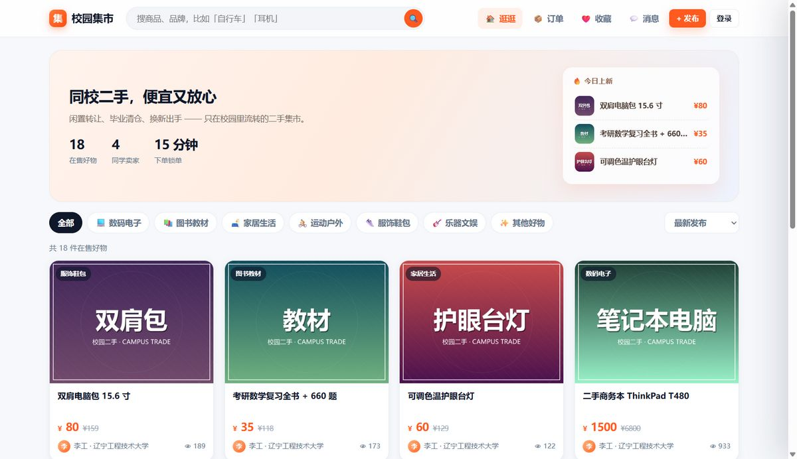
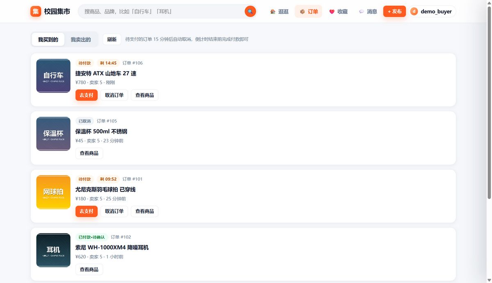

# 校园集市 · 校园二手交易平台

> 一个面向校园场景的二手交易系统：发布闲置、搜索浏览、下单支付、订单流转、留言收藏，全链路可跑通。
> 后端 Spring Boot 3 + MySQL + Redis + RabbitMQ，支付接入支付宝沙箱，使用 Docker 部署在云服务器。

**在线体验**：<http://49.232.39.241:8080/shop.html>
演示账号：`demo_buyer` / `123456`（另有 `test01` 等账号，密码同为 `123456`）



## 功能一览

| 模块 | 能力 |
|---|---|
| 用户 | 注册 / 登录（JWT）、昵称头像、拦截器统一鉴权 |
| 商品 | 发布（图片上传）、编辑、下架、分页查询、关键词搜索、分类筛选、价格排序、浏览数统计 |
| 收藏 | 收藏 / 取消收藏、收藏列表 |
| 留言 | 商品下留言、按商品查看留言、未读提示 |
| 订单 | 下单锁库存、买家取消、卖家确认、买家完成、超时自动取消 |
| 支付 | 支付宝电脑网站支付、同步回跳查单、异步通知验签、幂等落库 |

## 技术栈

| 层次 | 选型 |
|---|---|
| 语言 / 运行时 | Java 17 |
| 框架 | Spring Boot 3.3.5、Spring MVC、Spring AMQP |
| 持久层 | MyBatis-Plus 3.5.7、MySQL 8.0 |
| 缓存 | Redis（商品详情缓存、空值缓存、随机 TTL） |
| 消息 | RabbitMQ 3.13（TTL + 死信交换机实现延迟取消） |
| 认证 | JWT（jjwt 0.12.6）+ BCrypt 密码哈希 |
| 支付 | alipay-sdk-java 4.40（RSA2 签名、沙箱环境） |
| 前端 | 原生 HTML/CSS/JS 单页商城（无构建、响应式，桌面/手机两套布局） |
| 部署 | Ubuntu 22.04 + Docker 四容器（app / mysql / redis / rabbitmq） |

## 系统架构

```
                         ┌─────────────────────────────┐
   浏览器 (shop.html)  ──► │  Spring Boot (8080)         │
                         │  Controller → Service → Mapper
                         └──┬────────┬────────┬────────┘
                            │        │        │
                    ┌───────▼──┐ ┌───▼────┐ ┌─▼──────────┐
                    │ MySQL 8  │ │ Redis  │ │ RabbitMQ   │
                    │ 订单/商品│ │ 详情缓存│ │ 延迟取消队列│
                    └──────────┘ └────────┘ └────────────┘
                            ▲
                            │ alipay.trade.query 主动查单
                     ┌──────┴───────┐
                     │ 支付宝沙箱网关 │ ◄── 异步通知 notify_url
                     └──────────────┘
```

### 支付时序（核心链路）

```
浏览器         本服务                     支付宝
  │  点「去支付」│                            │
  │────────────►│ 生成带签名的表单 HTML        │
  │◄────────────│                            │
  │  提交表单 ───────────────────────────────►│ 收银台
  │                                          │ 用户付款
  │◄──────────── 302 return_url ─────────────│
  │────────────►│ 不信回跳参数，调 trade.query │
  │             │───────────────►│ 查单        │
  │             │ 仅 TRADE_SUCCESS 且金额一致  │
  │             │ 才 update ... where pay_status=0
  │             │◄────────────── notify（异步）│
```

## 关键技术实现

1. **缓存穿透 / 雪崩防护**
   查不到的商品写入 `__NULL__` 空值并设 60 秒过期，避免恶意 id 打到数据库；详情缓存的 TTL 在 10 分钟基础上叠加 0~120 秒随机值，打散过期时间，防止同一时刻集体失效。
   （缓存击穿考虑过互斥重建方案，因个人项目并发量低、收益不明显，暂未落地。）

2. **浏览量原子自增**
   `UPDATE item SET view_count = view_count + 1` 由数据库保证原子性，再回查一次取最新值返回，避免"读-改-写"丢更新；同时保证缓存里不会写入过期数值。

3. **订单 15 分钟自动取消（RabbitMQ TTL + 死信）**
   下单后向 `order.delay.queue` 投递订单号，队列级 TTL 到期后消息变成死信，被路由到 `order.timeout.queue`，监听器收到后调用 `timeoutCancel`。同时保留每 10 分钟一次的定时任务做兜底对账，消费端对"订单不存在 / 已取消 / 已支付"全部幂等跳过。

4. **支付幂等与防篡改**
   回跳和异步通知都**不使用**回调参数改状态，而是主动 `alipay.trade.query` 查单；写库使用条件更新
   `update orders set pay_status = 1, pay_time = now(), pay_no = ? where id = ? and pay_status = 0`，
   影响行数为 1 才视为首次支付成功，重复通知天然幂等。异步通知同时校验 RSA2 签名、`app_id`、`trade_status` 和**金额一致**。

5. **状态机守卫**
   `confirm / finish / cancel / timeoutCancel / 支付回调` 每个入口都校验当前 `status + pay_status`，条件更新带 `where` 约束，杜绝"已付款订单被取消""未付款订单被确认"这类脏状态。

6. **容器化部署**
   四个容器通过自定义 bridge 网络互联，服务之间用容器名当域名（`campus-mysql` / `campus-redis` / `campus-mq`）；配置外置为 `application-prod.yml` 挂载进容器，密钥文件以只读卷挂载且权限 600；数据目录挂载到宿主机，重启不丢数据。

## 快速开始（本地）

前置：JDK 17、Maven、MySQL 8、Redis、RabbitMQ。

```bash
# 1. 建库（utf8mb4）
CREATE DATABASE campus_trade DEFAULT CHARACTER SET utf8mb4;

# 2. 导入表结构与演示数据
mysql -uroot -p campus_trade < sql/schema.sql
mysql -uroot -p campus_trade < sql/demo-data.sql

# 3. 修改 application.yml 中的数据库/Redis/RabbitMQ 连接信息

# 4. 启动
mvn spring-boot:run
```

访问 <http://localhost:8080/shop.html>。

> 支付宝相关功能需要把 `alipay.app-id`、`private-key-path`、`alipay-public-key-path` 换成自己的沙箱参数；
> 不配置也能正常启动，只是支付接口不可用。

## Docker 部署

本地 `mvn package` 打出可执行 jar，`scp` 传到服务器；MySQL / Redis / RabbitMQ / 应用各起一个容器，
全部加入同一个自定义网络，服务之间用容器名互连（`campus-mysql` / `campus-redis` / `campus-mq`）。

```bash
docker network create campus

docker run -d --name campus-mysql --network campus --restart unless-stopped \
  -e MYSQL_ROOT_PASSWORD=*** -e MYSQL_DATABASE=campus_trade -e TZ=Asia/Shanghai \
  -v /opt/campus/data/mysql:/var/lib/mysql \
  -v /opt/campus/sql:/docker-entrypoint-initdb.d:ro \
  mysql:8.0 --character-set-server=utf8mb4 --collation-server=utf8mb4_unicode_ci

docker run -d --name campus-redis --network campus --restart unless-stopped \
  -v /opt/campus/data/redis:/data redis:7-alpine

docker run -d --name campus-mq --network campus --restart unless-stopped \
  -v /opt/campus/data/rabbitmq:/var/lib/rabbitmq rabbitmq:3.13-management

docker run -d --name campus-app --network campus --restart unless-stopped \
  -v /opt/campus/app.jar:/app/app.jar:ro \
  -v /opt/campus/application-prod.yml:/app/application-prod.yml:ro \
  -v /opt/campus/keys:/app/keys:ro -p 8080:8080 \
  eclipse-temurin:17-jre \
  java -Xmx512m -jar /app/app.jar \
  --spring.config.location=file:/app/ --spring.config.name=application-prod
```

## 项目结构

```
src/main/java/com/campus/trade
├── cache/          # 商品详情缓存（空值缓存 + 随机 TTL）
├── common/         # 统一返回体、异常、JWT、用户上下文
├── config/         # 拦截器、MyBatis-Plus、支付宝、RabbitMQ 配置
├── controller/     # 接口层
├── dto / vo        # 入参 / 出参
├── entity / mapper # 实体与 Mapper
├── mq/             # 延迟队列监听器
├── service/impl    # 业务实现（订单状态机、支付、收藏留言）
└── task/           # 订单超时兜底任务
src/main/resources/static
├── shop.html       # 演示商城页（响应式，单文件）
└── dev-tools.html  # 调试用接口面板
```

## 截图

| 商品详情 | 订单列表 |
|---|---|
|  |  |

## 说明

- 项目定位为**个人学习 / 求职展示**，未做多机部署、压测与高可用设计；
- 支付宝使用**沙箱环境**，不涉及真实资金；
- 演示数据中的商品与用户均为虚构。
